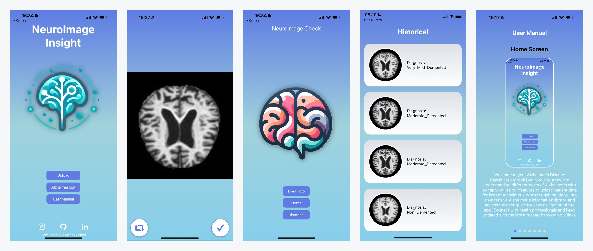
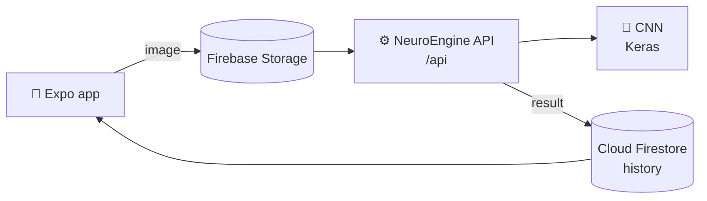

# NeuroImage Insight 🧠

Mobile app that **classifies brain MRI images into four Alzheimer's disease stages**. Built with
**React Native (Expo)** and **Firebase**, it sends each image to
[NeuroEngine](https://github.com/CuencaOscar/NeuroEngine), a Keras convolutional neural network served through a
Flask API, and keeps a history of every analysis.

Developed for my thesis *"Desarrollo de una aplicación móvil para clasificación de imágenes de Alzheimer mediante
aprendizaje automático"* at Universidad Técnica de Machala (UTMACH).


> **Research project, not a medical device.** Results must not be used for diagnosis.



## Features

- Capture or upload an MRI slice.
- Classification into `Non_Demented`, `Very_Mild_Demented`, `Mild_Demented` or `Moderate_Demented`, with probability.
- History stored in Cloud Firestore.
- Reference catalogue describing each stage.
- Built-in user manual.

## Architecture



## Tech stack

React Native 0.74 · Expo SDK 51 · React Navigation · React Native Paper · Firebase (Firestore, Storage) ·
expo-camera · expo-image-picker

## Getting started

Requirements: Node.js 18+, the Expo Go app or an emulator, a Firebase project with Firestore and Storage, and a
running instance of [NeuroEngine](https://github.com/CuencaOscar/NeuroEngine).

```bash
npm install
cp .env.example .env    # fill in your Firebase web config and API URL
npx expo start
```

| Variable | Description |
|---|---|
| `EXPO_PUBLIC_FIREBASE_*` | Firebase web app configuration |
| `EXPO_PUBLIC_API_URL` | Classification endpoint, e.g. `https://your-host/api` |

Configuration lives in [`src/config.js`](src/config.js); no keys are stored in the repository. Protect your Firebase
project with Security Rules before publishing a build.

## Project structure

```
src/
├── components/   # Cards, buttons, skeleton loaders, footer
├── navigation/   # Stack navigator
├── screens/      # Home, camera, upload, history, catalogue, manual
├── resources/    # UI texts
├── styles/       # Colours, themes and shared styles
├── utils/        # User manual content
├── config.js     # Environment configuration
└── firebaseConfig.js
```

## License

MIT © Oscar Cuenca · [LinkedIn](https://www.linkedin.com/in/ocuenca-moreno/)
